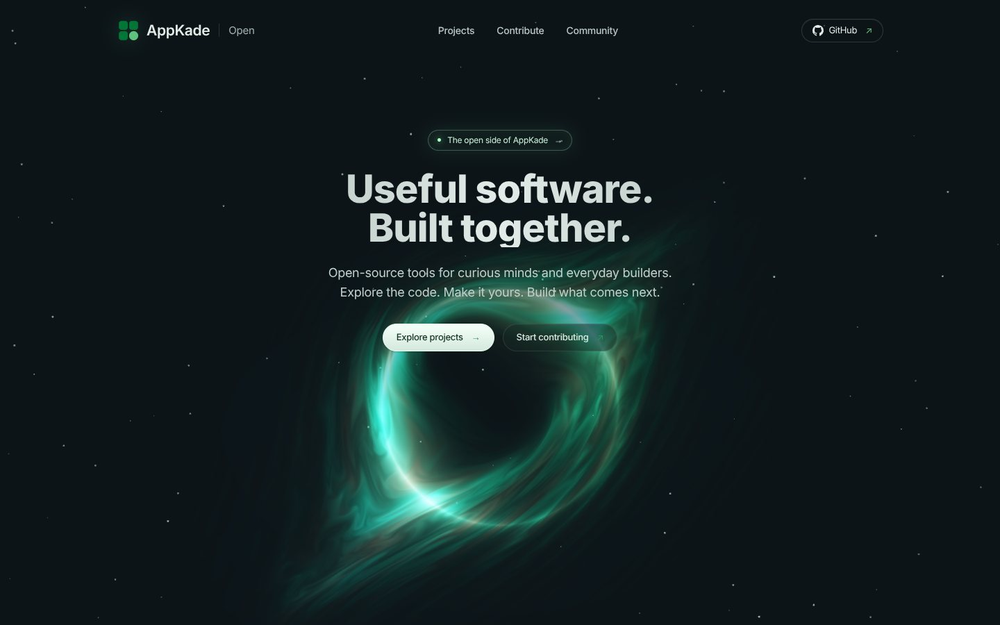

<div align="center">

<a href="https://open.appkade.lk">
  
</a>

# AppKade Open

**Useful software. Built together.**

Open-source tools for curious minds and everyday builders, and a home that recognises everyone who helps build them.

[](https://github.com/AppKade/open/actions/workflows/ci.yml)
[](https://github.com/AppKade/open/actions/workflows/deploy.yml)
[](LICENSE)
[](CONTRIBUTING.md)
[](https://astro.build)
[](https://pages.cloudflare.com)

[**Visit the site**](https://open.appkade.lk) · [**Start contributing**](CONTRIBUTING.md) · [**Report a bug**](https://github.com/AppKade/open/issues/new) · [**Suggest an idea**](https://github.com/AppKade/open/issues/new)

<br />

<a href="https://open.appkade.lk">
  
</a>

</div>

## ✨ What is AppKade Open?

AppKade Open is the open side of [AppKade](https://appkade.lk): one place to discover our open-source projects, learn how to run them, and get credit for improving them.

- 🧭 **Discover projects.** A community-ranked board of public AppKade tools, each with GitHub activity and setup steps you can copy and run.
- 🏅 **Get recognised.** Merged pull requests earn points and badges, verified straight from GitHub. No sign-up, no AppKade account.
- 🗳️ **Rank what matters.** Upvote the projects you care about with privacy-friendly, bot-protected anonymous votes; the board reorders live.
- 🌌 **Enjoy the view.** A hand-tuned WebGL black hole, a drifting starfield, and full respect for reduced-motion settings.

## 🧰 Projects you can contribute to

| Project | What it does | Status |
| :-- | :-- | :-- |
| [**LankaQR CLI**](https://github.com/AppKade/lanka-qr-cli) | Inspect QR payloads, parse TLV fields and verify CRC checksums offline. | 🧪 Experimental |
| [**Legacy Bridge**](https://github.com/AppKade/legacy-bridge) | Inspect SOAP/WSDL operations and run preliminary XML and import checks. | 🧪 Experimental |
| [**AppKade Open**](https://github.com/AppKade/open) | This website: project discovery and contributor recognition. | 🧪 Experimental |
| [**Singularity**](https://github.com/AppKade/singularity) | An animated WebGL black hole for your website, with a live [playground](https://appkade.github.io/singularity/). | 🧪 Experimental |
| [**LK Tax MCP**](https://github.com/AppKade/lk-tax-mcp) | Local Sri Lankan income tax estimates through MCP. Development preview, not ready for filing. | 🧪 Experimental |
| [**LK Transit MCP**](https://github.com/AppKade/lk-transit-mcp) | Requirements and research for a Sri Lankan bus transit MCP. No runnable server yet. | 📋 Planned |

Every merged PR to any of these repositories counts toward your recognition on [open.appkade.lk](https://open.appkade.lk/#community).

## 🚀 Quick start

You need **Node.js 22.12+** and **pnpm 10**.

```sh
git clone https://github.com/AppKade/open.git
cd open
corepack enable
pnpm install
pnpm dev
```

Open the URL Astro prints, and you're running the site locally. Before opening a pull request, run the same checks as CI:

```sh
pnpm test      # unit tests (node --test)
pnpm check     # type checking
pnpm build     # production build into dist/
```

Run a single test file with `node --test tests/scoring.test.mjs`.

## 🤝 Contributing

We'd love your help, whether it's your first open-source PR or your five-hundredth.

1. **Find something to do.** Browse [open issues](https://github.com/AppKade/open/issues), or open one to propose an idea.
2. **Make a focused change.** Fork, branch, and keep each PR to one improvement.
3. **Open a pull request** against `main`, explaining what changed and how to test it. Screenshots help for visual changes.

Read the full [contributing guide](CONTRIBUTING.md) before you start, and please follow our [code of conduct](CODE_OF_CONDUCT.md).

### How recognition works

Points come from merged PRs on registered public AppKade repositories, based on the label a maintainer applies:

| Label | Points |
| :-- | --: |
| `type:feature` | 10 |
| `type:fix` | 8 |
| `type:docs` | 5 |
| `type:test` | 5 |
| Any other merged PR | 3 |
| Your first eligible PR | **+5 bonus** |

Badges: **First Contributor** (1 PR), **Active Builder** (3 PRs), **Core Contributor** (10 PRs). Stars, followers and votes never count toward points. Full details are in the [recognition policy](docs/recognition.md).

## 🏗️ How it's built

| Layer | Technology |
| :-- | :-- |
| Site | [Astro](https://astro.build), statically generated as a single page |
| Styling and motion | Hand-written CSS, a canvas starfield, and a WebGL shader adapted from XorDev's “Singularity” |
| Hosting | [Cloudflare Pages](https://pages.cloudflare.com) |
| Votes API | Cloudflare Pages Functions + [D1](https://developers.cloudflare.com/d1/) |
| Bot protection | [Cloudflare Turnstile](https://www.cloudflare.com/products/turnstile/) |
| Contribution data | GitHub REST API, snapshotted at build time |

GitHub is the source of truth for projects and contribution history; D1 stores anonymous project votes only. See [ARCHITECTURE.md](ARCHITECTURE.md) for how the pieces fit together.

<details>
<summary><strong>📁 Repository layout</strong></summary>

<br />

| Path | What lives there |
| :-- | :-- |
| `src/pages/index.astro` | The whole public page. Other pages only redirect legacy URLs. |
| `src/styles/open.css` | All styles. |
| `src/scripts/` | Client scripts: starfield and motion toggle (`motion.ts`), WebGL hero black hole (`singularity.ts`), project ranking (`ranking.ts`). |
| `src/components/` | `Brand` and the per-project `Vote` widget. |
| `src/lib/` | Data loading and the contributor scoring rules. |
| `data/` | Project registry and generated contributor and project-activity snapshots. |
| `scripts/sync-github.mjs` | Builds contributor data from merged GitHub PRs. |
| `functions/api/votes/` | Cloudflare Pages Function for votes. |
| `migrations/` | D1 schema and the voting allowlist. |
| `tests/` | Node test runner suites. |
| `docs/` | Recognition policy and README assets. |

</details>

<details>
<summary><strong>🛠️ For maintainers: registry, voting and deployment</strong></summary>

### Project registry

Edit `data/projects.json` with verified public repositories owned by the AppKade organization. Include the **numeric** GitHub repository ID. New projects require a working README and actual installation instructions; do not invent release or contributor metrics. To make a project votable, also add a numbered migration in `migrations/` that inserts its `repo_id` and `slug` into `published_projects`.

`pnpm sync` generates `data/contributors.json`, `data/activity.json` and `data/project-stats.json` from GitHub. To give a project a custom icon, add a square PNG at `public/images/projects/<slug>.png`; otherwise its initials are shown. Adding `public/og-image.jpg` (1200×630) turns on link previews. The deploy workflow syncs before every build without pushing generated files back to git, so do not commit sync output.

### D1 voting

Provisioned database `appkade-open`, region APAC, D1 binding `DB`. Apply migrations locally with `pnpm db:local` and on Cloudflare explicitly with `pnpm db:remote`. `published_projects` is an allowlist; only verified registered projects may be voted on.

Create a Turnstile widget with hostname `open.appkade.lk` (and your preview domain if using a preview), then set `PUBLIC_TURNSTILE_SITEKEY` for the build and `TURNSTILE_SECRET` and `VOTE_COOKIE_SECRET` for Pages Functions (see `.env.example`). Never commit secrets. Voting uses Turnstile siteverify, same-origin requests, signed HttpOnly identity cookies and SQL uniqueness constraints. Anonymous cookies are not one-person-one-vote; votes are a community interest signal only.

To preview the votes API locally with SQLite persistence:

```sh
pnpm db:local
pnpm build
pnpm preview
```

### CI/CD

`ci.yml` runs tests, type checking and the build on pull requests and `main`. `deploy.yml` syncs GitHub, tests, builds and uploads via Wrangler Direct Upload on `main`, daily at 02:15 UTC and manually. It needs the GitHub Actions secrets `CLOUDFLARE_API_TOKEN` (Cloudflare Pages Edit scope) and `CLOUDFLARE_ACCOUNT_ID`. A Cloudflare Git integration is **not** used, to avoid duplicate builds. Deploy only from `main`; untrusted PRs receive no production secrets.

### Scope and boundaries

No marketplace database, no AppKade accounts, no extra auth provider, and no admin app. No implicit publishing of all organization repositories. Future community records can be added to D1 via reviewed migrations only.

</details>

## 💚 Contributors

Thanks to everyone who has helped build AppKade Open.

<a href="https://github.com/AppKade/open/graphs/contributors">
  
</a>

## 🛡️ Community and support

- 💬 Questions and ideas: [open an issue](https://github.com/AppKade/open/issues)
- 🔒 Security reports: follow [SECURITY.md](SECURITY.md); please don't use public issues
- 🧑‍🤝‍🧑 Expected behaviour: [Code of conduct](CODE_OF_CONDUCT.md)
- 🙈 Corrections or opting out of recognition: [request it in an issue](https://github.com/AppKade/open/issues)

## 📄 License

MIT license for this website's original code. The hero shader in `src/scripts/singularity.ts` is adapted from XorDev and licensed CC BY-NC-SA 3.0, which restricts commercial reuse. See [LICENSE](LICENSE). Other AppKade projects carry their own licenses; some previews have not selected a license yet. Inter is used under the [SIL Open Font License](public/fonts/Inter-LICENSE.txt).

<div align="center">
<br />

**[open.appkade.lk](https://open.appkade.lk)** · Made with 💚 by AppKade and the community

<sub>If AppKade Open is useful to you, consider giving it a ⭐ on GitHub.</sub>

</div>
